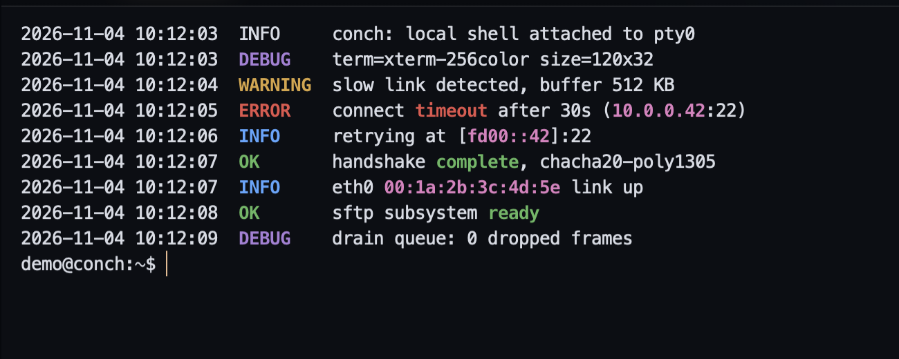
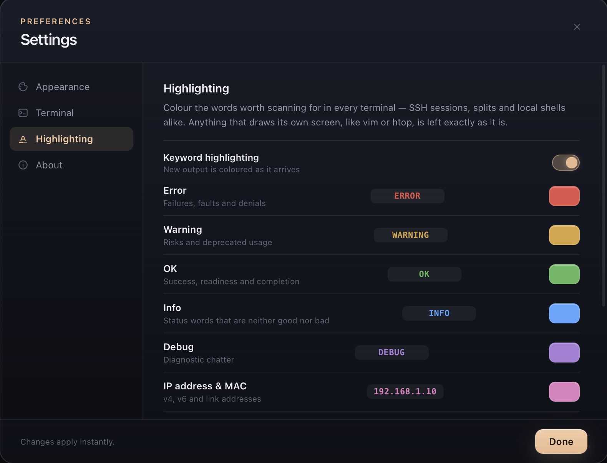
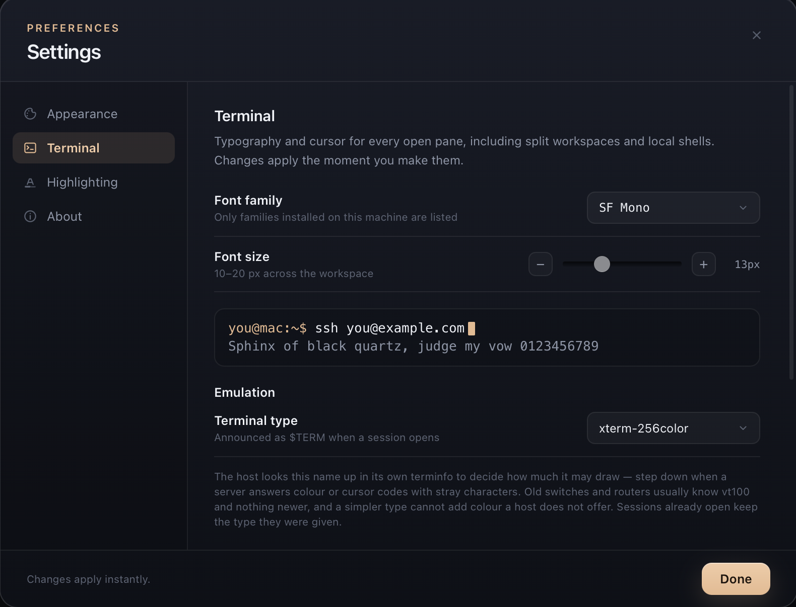

# 开源｜我用 Go + React 写了一个 macOS / Windows 原生 SSH 终端：Conch 0.2.0

> 一个窗口装下所有服务器：标签页、分屏、内嵌 SFTP、广播输入，还有会自己变色的日志。

## 先说结论

Conch 是一个开源的 SSH 与本地终端客户端，支持 macOS 12+ 和 Windows 10/11，Intel/AMD 与 ARM64 都有包。它用 Wails v3 搭建：Go 负责 SSH、PTY 和 SFTP，React 负责界面，终端是 xterm.js + WebGL，跑在系统自带的 WKWebView / WebView2 里——不是 Electron，不打包 Chromium。

- 项目地址：https://github.com/Merbeleue/conch
- 0.2.0 下载：https://github.com/Merbeleue/conch/releases/tag/v0.2.0
- 许可证：MIT



## 为什么又造一个 SSH 客户端

我日常要同时连好几台机器：一台跑服务、一台看日志、一台做部署。用过的工具各有取舍，但总有一两个地方不顺：有的多窗口管理很弱，有的传文件要另开一个窗口，有的把终端塞进浏览器壳里，内存和启动速度都不太对。

我想要的其实很具体：**一个原生窗口，里面能开很多会话，切换时不丢滚动缓冲，分屏时不用重新连接，传文件时不用离开当前标签。**

于是有了 Conch。它不追求功能清单最长，而是把“每天都要用”的那几件事做顺。

## 日常用起来是什么样

### 会话：标签页与分屏

每个 SSH 会话或本地 shell 都是一个标签，切走再切回来，滚动内容还在。

分屏不是“再开一个窗口”，而是把**已经连上的会话**停靠到当前标签里：`⌘D` 向右分，`⇧⌘D` 向下分（Windows 上把 `⌘` 换成 `Ctrl`）。多个会话可以选一个进来，拖拽标签或面板标题到任意一边，就能拼出左、右、上、下四种布局。拖动分屏线调整大小，双击恢复均分。

一个标签里装了多个面板后，它会自动变成“工作区”，标题根据里面的主机会自动生成，比如 `Alpha + Bravo`；手动改名后就不再自动跟随。整个过程不会重连，SSH 会话和滚动缓冲都保持原样。

### 主机管理：保存、分组、搜索

常用主机可以保存名称、地址、端口、用户名、认证方式和分组。侧栏支持按名称或 IP 搜索，`⌘F` 直接跳到搜索框；右键可以连接、复制一份、编辑、移动到分组或删除。分组可以折叠，新分组在输入时自动提示。

第一次连接某台主机时，会显示主机密钥指纹，确认后写入 `~/.ssh/known_hosts`。认证支持密码和私钥（带 passphrase，系统原生选文件框）；私钥登录失败时，报错会说明尝试了哪些文件、每个文件为什么不可用，而不是只丢一句“认证失败”。

### SFTP：不离开当前标签

顶部的 SFTP 按钮会在当前标签内打开一个双栏文件管理器：左边是本地文件系统，也可以切换成另一个在线会话；右边是当前主机。两边都有可编辑的路径栏。

复制支持按钮、双击和拖拽；文件夹递归传输，本地到远端、远端到本地、远端到另一台远端都可以。目标已存在同名文件时会列出冲突，让你选“覆盖”还是“跳过”；文件夹和跳过的文件会用 `(1)`、`(2)` 后缀区分，复制到自身会被直接拒绝，避免把原文件截断。

右键文件可以重命名、修改权限（Linux 主机，八进制输入并实时预览 `-rwxr-xr-x`）或删除。本地删除进 macOS 废纸篓或 Windows 回收站；远端删除会明确提示“永久删除”。传输时有一张浮动进度卡，显示百分比、字节数、当前文件，可以取消，结束后自动消失。

按 `Esc` 或点击 Terminal 按钮就回到还在后台运行的 shell——主机标签一直在，不需要在终端和文件管理器之间来回切窗口。

### 广播输入：一次操作，多台生效

打开 Broadcast 后，当前面板的按键会同步到所有在线会话。适合在多台机器上执行同一条命令、同时 `tail` 同一份日志。只剩一个会话时，这个按钮会自动关闭，避免误操作。

### 主题、字体与光标

内置八套主题：五套深色（Conch、Tide、Grove、Nebula、Graphite）和三套浅色（Dawn、Paper、Mist）。主题会同时改变窗口外壳和终端调色板，可以全局设置，也可以给单台主机单独指定，连上后自动接管窗口。

字体列表只显示系统真正安装了的字体（macOS 上是 SF Mono、JetBrains Mono、Menlo 等，Windows 上是 Cascadia Mono、Consolas 等），字号 10–20px；光标支持方块、竖线、下划线，可以开关闪烁。所有已打开的面板都会立即生效，分屏里的也一样。

## 0.2.0 新增了什么

### 关键字高亮：日志自己会说话

这是 0.2.0 最有存在感的功能。终端输出里的错误、警告、成功、状态词、调试信息和 IPv4/IPv6/MAC 地址，会按规则实时着色：ERROR 是红的，WARNING 是黄的，OK 是绿的，INFO 是蓝的，DEBUG 是紫的，地址是粉的。每条规则的颜色都能在“设置 → Highlighting”里单独改，取色器是应用自绘的，带预设色和十六进制输入。

它实现上有几个刻意的选择：

- 颜色是作为 ANSI 序列**写进输出流**的，不是覆盖层，所以选中复制出来的仍然是纯文本；
- 遇到带转义序列的行会原样放行，vim、htop、less 这类自己画屏幕的程序不会被染色；
- 输入会等一小段空闲再整行处理，避免把半行日志切开，也避免高频输出时拖慢终端。



### 终端类型（$TERM）

有些老交换机、路由器或精简系统的 terminfo 不认识现代 xterm，连上后颜色和光标控制会乱。0.2.0 可以在“设置 → Terminal”里选择 `$TERM`：从 `xterm-256color`、`xterm`、`linux`、`ansi`、`vt220` 一直到 `vt100`，SSH 会话和本地 shell 都适用。新连接和重连会使用当前值，已经打开的会话保持原样。



### 右键粘贴

这是一个很多人习惯、但并非所有终端都默认提供的操作。打开“设置 → Terminal → Mouse”里的右键粘贴后：

- 选中文本即自动复制；
- 右键直接粘贴选中的内容；没有选中时粘贴剪贴板；
- 粘贴仍走 xterm 的 bracketed paste 和多行保护，不会把多行命令拆成多次执行。

默认关闭，关闭时保持各平台原生的右键行为（macOS 右键选词、Windows 保持默认）。

### 一些顺手的小修

- 在 SFTP 里点击当前主机标签就能回到终端，不用再找按钮；
- 新建主机表单里端口 22 改成灰色提示，留空仍然连 22；
- 设置页的 Done 按钮固定在底部，长页面不用滚到底才能保存；
- 修复了开启右键粘贴后，右键会覆盖已选中文本的问题。

## 下载与安装

所有安装包都在 Release 页面，每个平台两种包，另外各带一份 `.sha256.txt` 校验文件：

| 平台 | 文件 | 说明 |
| --- | --- | --- |
| macOS | `Conch-0.2.0.dmg` | 通用二进制，Apple Silicon 与 Intel 通用，macOS 12+ |
| macOS | `Conch-0.2.0.tar.gz` | 解压即用，适合习惯命令行的用户 |
| Windows | `Conch-0.2.0-windows-installer.exe` | 同时含 x64 与 ARM64，安装时自动选择 |
| Windows | `Conch-0.2.0-windows-portable.zip` | 免安装，解压运行 `conch.exe` 或 `conch-arm64.exe` |

macOS 上如果不想处理隔离属性，可以直接：

```bash
curl -fsSL https://github.com/Merbeleue/conch/releases/download/v0.2.0/Conch-0.2.0.tar.gz \
  | tar -xz -C /Applications
```

**需要提前说明的两件事：**

1. macOS 包目前是 ad-hoc 签名、尚未公证，首次打开会被 Gatekeeper 拦下。双击一次后，到“系统设置 → 隐私与安全性”点“仍要打开”。macOS 15 上右键打开已经不再是绕过方式。
2. Windows 包没有代码签名，SmartScreen 会提示“Windows 已保护你的电脑”，点“更多信息 → 仍要运行”。如果系统缺 WebView2，安装器会自动拉取运行时。

安装器是当前用户级别，不会弹管理员权限；Windows 版不需要额外安装 OpenSSH。

## 一些实现细节

**为什么选 Wails 而不是 Electron。** 我需要 Go 的 `x/crypto/ssh` 和系统 PTY，又不想为了界面塞进整个 Chromium。Wails v3 的做法是 Go 后端 + 系统 WebView：macOS 用 WKWebView，Windows 用 WebView2。窗口启动快，空闲时安静，安装包也小。代价是两套 WebView 的细节差异要自己抹平，Windows 上的帧率和字体枚举就花了不少时间。

**本地 shell 不是“假装本地”。** macOS 上是真正的登录 shell 跑在 PTY 上；Windows 上走 ConPTY，按 PowerShell 7 → Windows PowerShell → `cmd` 的顺序找可用 shell。所以本地的颜色、补全、作业控制都能正常工作。

**SFTP 是独立子系统，不是终端里跑 `sftp`。** 传输在 Go 侧完成，前端只负责交互和进度；递归、冲突处理、权限修改都是原生实现，不依赖远端装了什么工具。

**所有数据都在本地。** 没有账号、没有遥测、没有更新检查。保存的主机、主题、偏好都放在 WebView 的 localStorage 里。

## 已知不足

说优点也得说清楚边界：

- 发布包尚未签名/公证，首次运行需要手动放行，企业环境批量部署会不方便；
- 勾选“保存密码/保存 passphrase”后，值以明文存在 WebView 的 localStorage 中，只适合在可信设备上使用；
- 端口转发（本地、远程、SOCKS）还没有；
- 还不能导入 `~/.ssh/config`；
- 关闭应用后不会恢复上次的标签页；
- Windows 路径的实测时间比 macOS 少，遇到平台差异欢迎提 issue。

这些都在 README 的 Roadmap 里，优先级会按反馈调整。

## 最后

Conch 解决的是我自己的日常问题，但如果你也经常在几台服务器之间来回切，它可能正好合适。项目是 MIT 协议，代码、构建脚本和打包流程都在仓库里；觉得有用的话，点个 Star 就是最大的鼓励。发现问题或有想要的功能，直接开 issue，我会尽量回。

- GitHub：https://github.com/Merbeleue/conch
- v0.2.0 Release：https://github.com/Merbeleue/conch/releases/tag/v0.2.0
- 更新日志：https://github.com/Merbeleue/conch/blob/main/CHANGELOG.md
